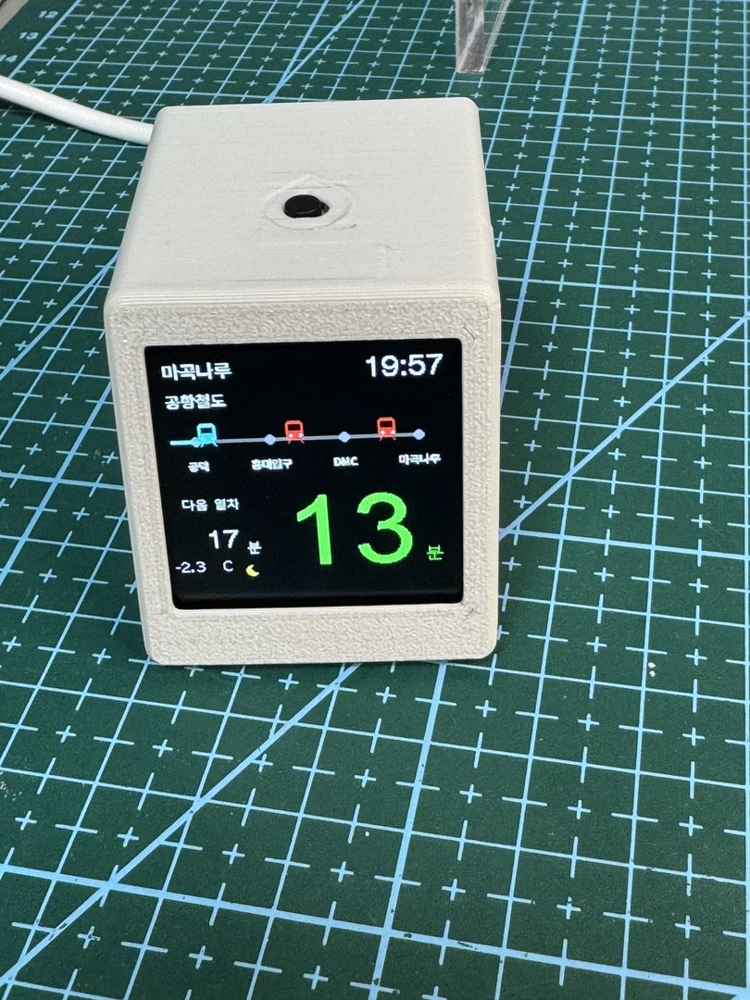
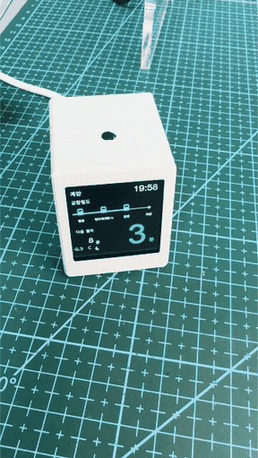
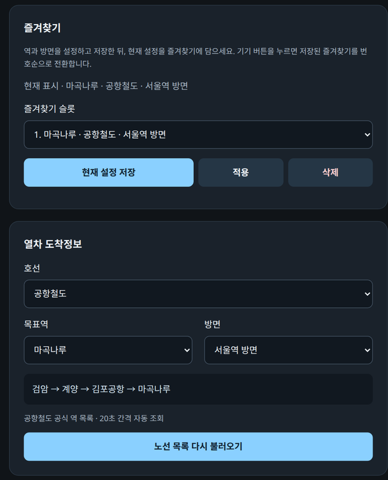
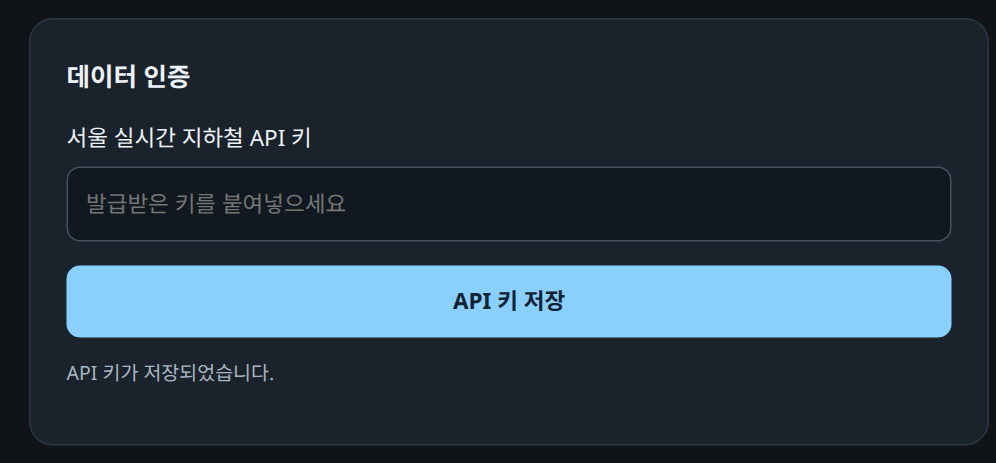
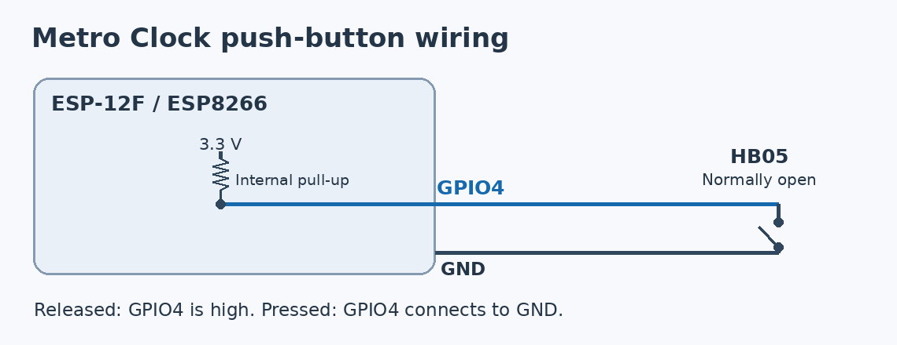
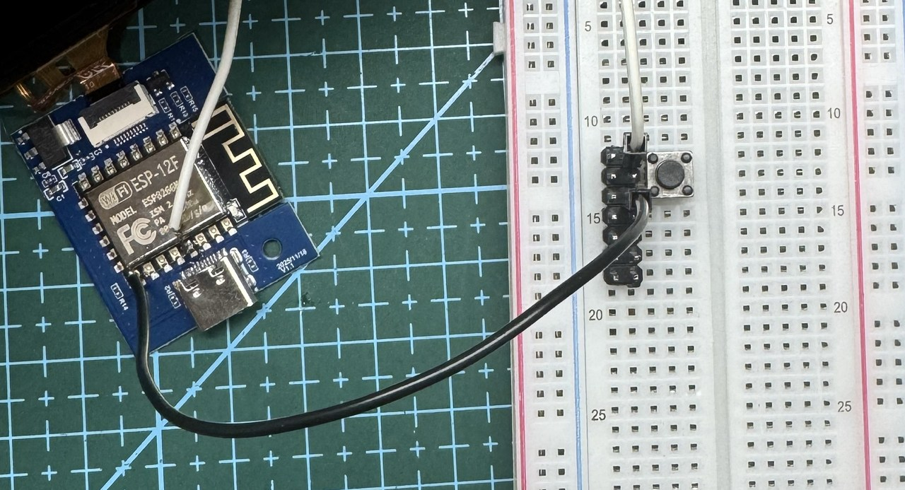
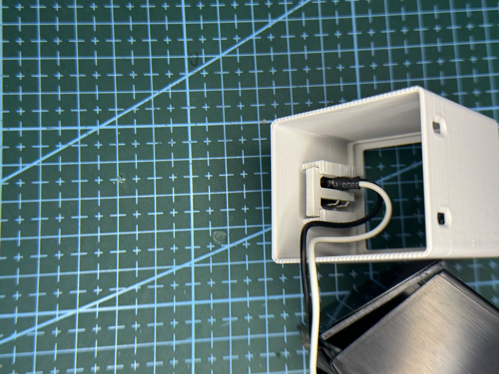
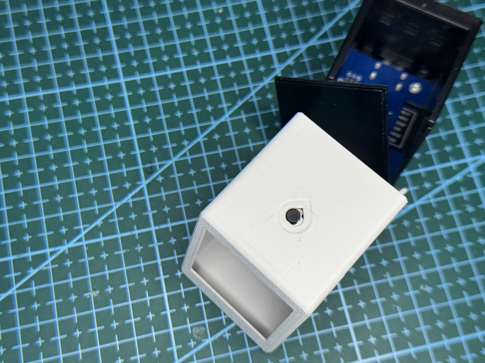
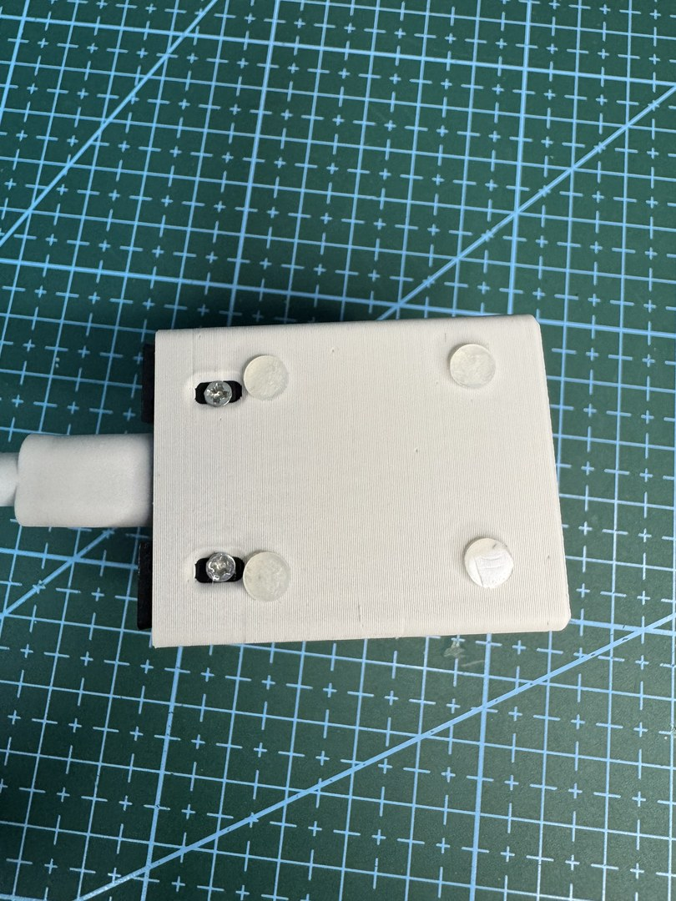

# Metro Clock

[English README](README.md) · [펌웨어 설치](#펌웨어-설치) · [버튼과 케이스 제작](#버튼과-케이스-제작)

Metro Clock은 **ESP8266 기반 SD Pro 스마트 날씨 시계**를 수도권 지하철 도착정보 표시기로 바꿉니다. 입력한 도보 시간을 기준으로 탑승 가능한 첫 열차를 강조합니다.

<p align="center">
  
  
</p>

## 주요 기능

- 수도권 19개 노선의 역 선택, 실시간 도착정보와 서울 날씨 표시
- 노선, 역, 방면, 진입 경로, 도보 시간, 밝기를 즐겨찾기 5개에 저장
- GPIO4에 연결한 버튼으로 저장된 즐겨찾기를 번호순으로 전환
- 설정 웹페이지와 시계 화면은 기본 **한국어**이며 **English**로 전환 가능
- 시계의 웹페이지에서 Wi-Fi 설정 및 펌웨어 업데이트

## 설정 화면

시계 화면에 표시된 주소로 접속해 기기 비밀번호로 로그인합니다. **표시 언어**에서 한국어와 영어를 바꿀 수 있습니다. [서울 지하철 API 키를 등록한 뒤](#서울-실시간-지하철-api-키-등록) 노선, 역, 방면을 선택하고 **저장하고 적용**을 누릅니다. 이 설정을 보관하려면 **즐겨찾기**에서 슬롯을 선택하고 **현재 설정 저장**을 누르세요.



페이지 맨 아래의 **Wi-Fi · 비밀번호 · 펌웨어 관리**를 누르면 `/system`이 열립니다.

## 지원 기기와 준비물

| 지원 기기 | 하드웨어 | 설치를 테스트한 순정 펌웨어 |
| --- | --- | --- |
| SD Pro 스마트 날씨 시계 | ESP-12F / ESP8266, 4 MB 플래시, 240 × 240 ST7789 | `SDPro_V1.0.6` |

기판은 [SD Pro 하드웨어 문서](docs/specifications/hardware.md)에서 확인할 수 있습니다. 버튼을 추가하려면 아래 부품을 준비하세요.

| 부품 | 준비할 것 |
| --- | --- |
| 전원 | USB-C |
| 스위치 | HB05 택트 스위치, **6 × 6 × 5 mm**, **관통형 4핀(DIP-4)**, 평상시 열려 있는 순간 동작형 |
| 배선 | 얇은 피복 전선 2가닥, 인두, 멀티미터 |
| 출력물 | 교체용 외장 케이스와 치수 확인용 게이지. 기존 내부 트레이, 후면 패널, 나사는 재사용합니다. |

## 펌웨어 설치

이 저장소를 복제하거나 ZIP으로 내려받으세요. 펌웨어는 소스에서 직접 빌드합니다. PC가 인터넷에 연결된 상태에서 빌드를 먼저 마치세요.

### 방법 1. 에이전트로 설치하기 (추천)

Codex나 Claude에서 이 저장소를 열고 다음과 같이 요청하세요. “[`docs/INSTALL_AGENT.md`](docs/INSTALL_AGENT.md)를 읽고 내 SD Pro에 Metro Clock을 설치해 줘.”

### 방법 2. 직접 설치하기

1. **펌웨어를 빌드합니다.** Python 3와 pip를 설치하고 저장소 루트에서 아래 명령을 실행하세요. 시스템에 따라 `python3`을 사용하거나 Python 가상환경을 활성화해야 할 수 있습니다.

   ```sh
   python -m pip install -r requirements-build.txt
   python scripts/make_release.py
   ```

   빌드가 끝나면 `release/SDPro_MetroClock_*.bin`이 생성됩니다. SHA-256 값은 `release/SHA256SUMS.txt`에서 확인하세요.
2. **펌웨어를 올립니다.** 나중에 순정 펌웨어로 돌아가려면 교체하기 전에 플래시 전체를 백업하세요. 처음 설치할 때는 순정 SD Pro의 현재 IP로 접속해 업데이트 페이지를 사용하세요. 파일명의 `SDP` 접두사를 유지합니다. Metro Clock을 업데이트할 때는 시계의 현재 주소에서 `/system`에 로그인하고 **Firmware update**를 사용하세요. 재부팅될 때까지 USB 전원을 유지합니다. [백업 및 복구](docs/MIGRATION.md)
3. **설정 페이지와 노선 목록을 설치합니다.** 재부팅 후 화면에 표시된 비밀번호로 **Smart Weather Clock** Wi-Fi에 연결하세요. 아래 명령에서 같은 비밀번호를 입력합니다. 시계가 이미 공유기에 연결되어 있다면 화면에 표시된 LAN IP를 사용하세요.

   ```sh
   python scripts/metro_assets.py http://192.168.4.1
   ```

4. **시계를 Wi-Fi에 연결합니다.** 처음 설정한다면 `http://192.168.4.1/system`에 로그인해 공유기 정보를 입력하고 **Save and restart**를 누르세요.
5. **[API 키를 등록합니다](#서울-실시간-지하철-api-키-등록).** 키를 저장한 뒤 노선, 역, 방면을 선택하고 **저장하고 적용**을 누르세요.

### 서울 실시간 지하철 API 키 등록

1. 서울 열린데이터광장에 로그인합니다. [서울시 지하철 실시간 도착정보](https://data.seoul.go.kr/dataList/OA-12764/F/1/datasetView.do)의 **Open API → 인증키 신청 (지하철)**에서 개인 키를 발급받으세요.
2. 시계 화면에 표시된 LAN IP로 접속해 로그인합니다. **데이터 인증** (**Data access**)에서 키를 붙여넣고 **API 키 저장** (**Save API key**)을 누르세요. **API 키가 저장되었습니다**라는 메시지가 뜨면 역과 방면을 선택하세요.

   

서울 열린데이터광장 노선은 저장된 키로 조회합니다. 공항철도는 운영사 데이터를 사용합니다.

## 버튼과 케이스 제작

### 버튼 연결 및 테스트



1. USB 전원을 빼고 **GPIO4**와 **GND**에 전선을 각각 납땜합니다. [기판 사진](docs/specifications/board-esp12f.jpg)에서 구리 안테나가 오른쪽에 있을 때, GPIO4는 아래쪽 8개 패드 중 오른쪽에서 네 번째입니다. 납땜 전에 실제 기판의 패드와 GND를 확인하세요. [ESP-12F 핀 배치](https://docs.ai-thinker.com/_media/esp8266/docs/esp-12f_product_specification_en.pdf)
2. 멀티미터로 **누를 때만** 연결되는 스위치 다리 두 개를 찾고 GPIO4와 GND 사이에 연결합니다.
3. 전원을 연결하기 전에 납땜이 인접 패드에 닿지 않는지와 버튼을 누를 때만 GPIO4와 GND가 연결되는지 확인합니다. 전원을 켠 뒤 즐겨찾기를 두 개 이상 저장하고 전환을 테스트하세요.



### 출력 케이스 조립

[외장 케이스 STL](hardware/enclosure/outer-shell-v3.stl) · [HB05 고정판 STL](hardware/enclosure/hb05-slide-retainer-v3.stl) · [CAD, 맞춤 게이지, 출력 방향](hardware/enclosure/README.md)

1. **케이스에 버튼을 끼웁니다.** 배선한 스위치를 케이스 안쪽에서 끼우고, 뒤에서 v3 고정판을 밀어 넣습니다. 전선에 여유를 두고 버튼이 잘 돌아오는지 확인하세요.

   

2. **기존 트레이를 밀어 넣습니다.** 화면을 앞 베젤 쪽으로 향하게 하고 케이스 뒤에서 넣습니다. 전선이 트레이 모서리나 화면 리본 케이블에 걸리지 않게 정리하세요.

   

3. **바닥 나사 두 개를 조입니다.** 나사를 느슨하게 끼우고 베젤이 화면을 누르지 않게 위치를 맞춘 뒤 가볍게 조입니다. USB-C를 연결하고 버튼으로 즐겨찾기가 전환되는지 확인하세요.

   

## 복구

시계가 부팅 중 멈추면 전원을 켠 뒤 10초 이내에 끄는 동작을 두 번 하고, 세 번째에는 전원을 켜 둡니다. 화면에 **Recovery**가 나오면 비밀번호 없이 **Smart Weather Clock** Wi-Fi에 연결하고 `http://192.168.4.1/system`에서 정상 동작이 확인된 펌웨어를 올리세요. 순정 펌웨어로 복원하려면 플래시 전체 백업과 UART 연결이 필요합니다. [펌웨어 전환과 복구 안내](docs/MIGRATION.md)

## 사용 시 참고

- 화면의 열차 위치는 추정치이며 도착 시각은 철도 데이터의 갱신 상태에 따라 달라집니다.
- 시계는 로컬 HTTP로 설정 페이지를 제공합니다. 신뢰할 수 있는 네트워크에서 사용하세요.

## 프로젝트 문서

| 항목 | 위치 |
| --- | --- |
| 펌웨어 및 웹페이지 | [`src/`](src/) · [`web/`](web/) |
| 빌드 및 검증 | [펌웨어 빌드](#방법-2-직접-설치하기) · [테스트](tests/README.md) · [변경 기록](CHANGELOG.md) |
| 데이터 출처 | [서울 열린데이터광장](https://data.seoul.go.kr/dataList/OA-12764/F/1/datasetView.do) · [공항철도](https://www.airportrailroad.com/train/normal/live) · [Open-Meteo](https://open-meteo.com/) · [조회 주기](data/AREX-source-notes.md) |

## 라이선스

[GPL-3.0](LICENSE). [SmartClock-OSS](https://github.com/michaeldale/smartclock-oss)를 기반으로 합니다. 외부 데이터와 서비스에는 각 제공처의 조건이 적용됩니다.
