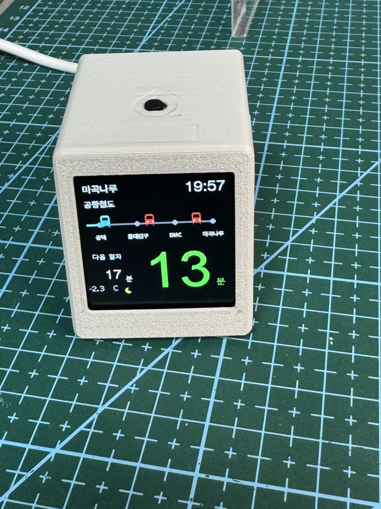
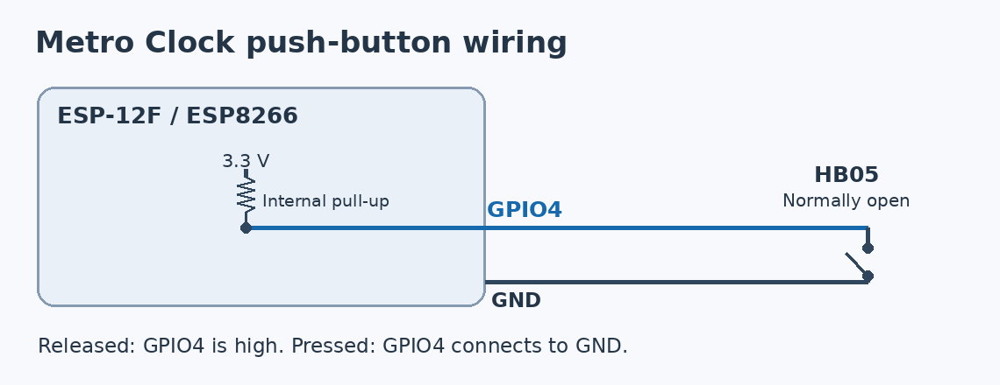
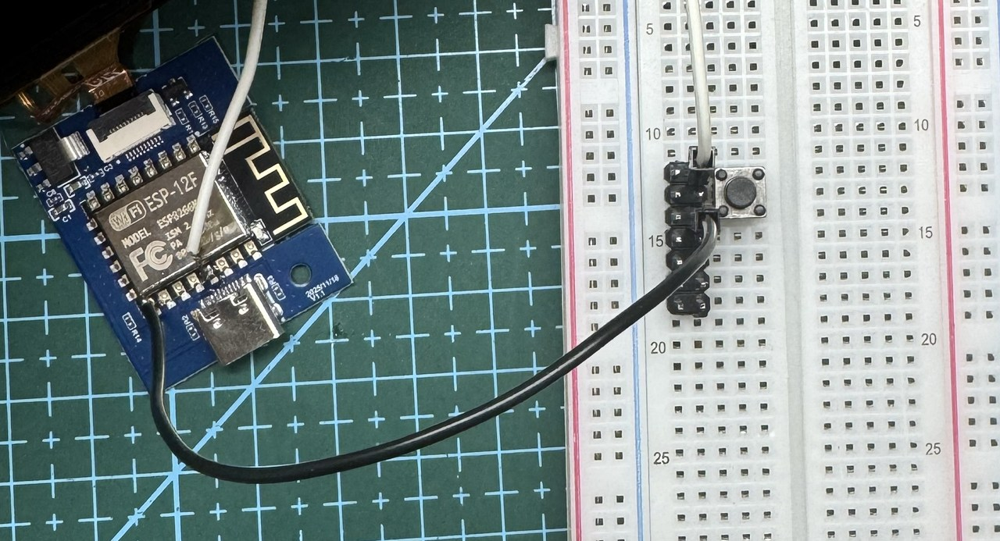
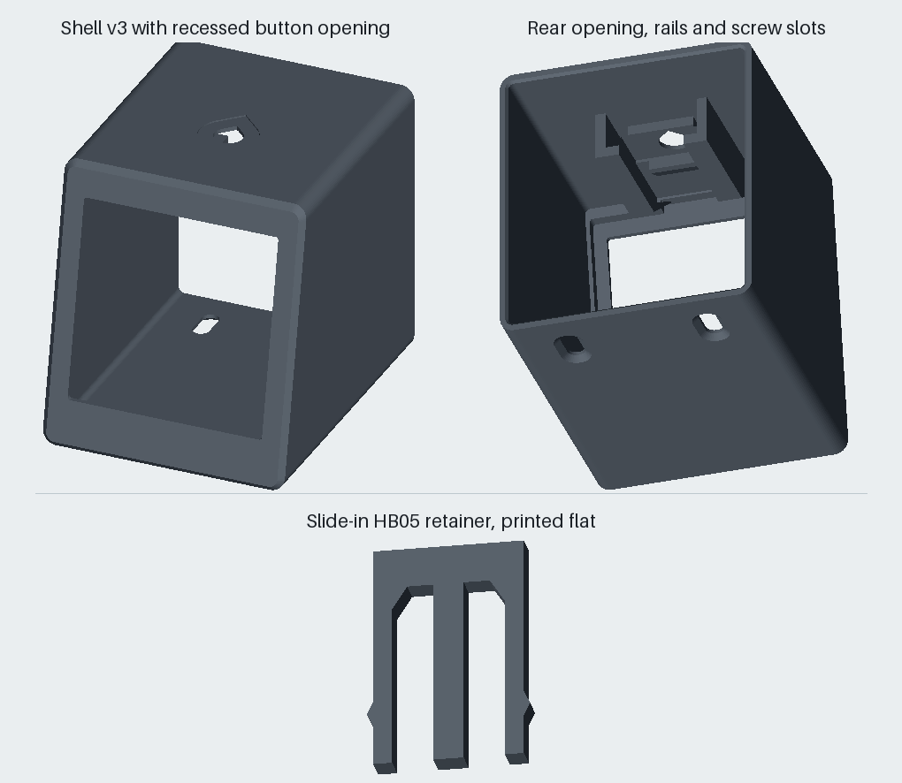
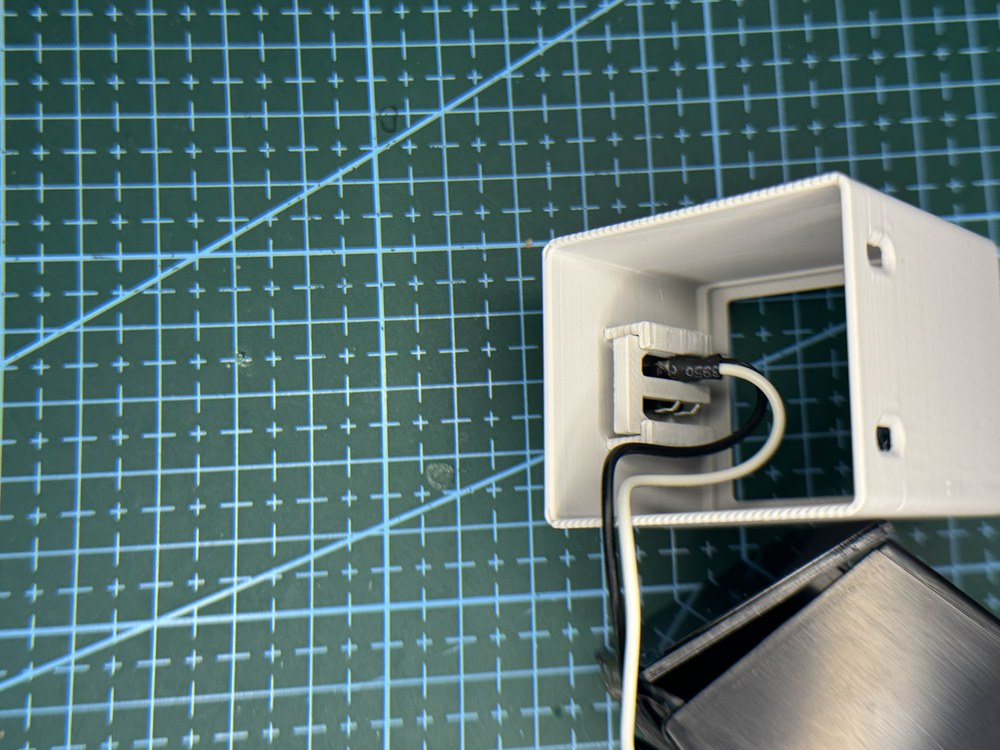
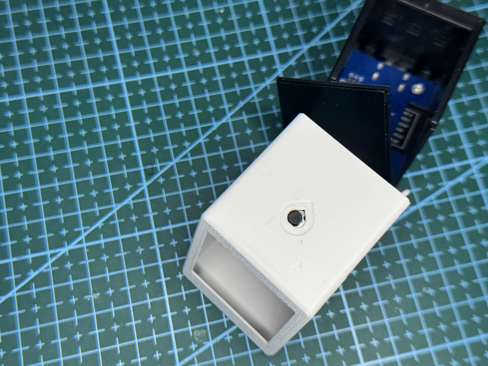
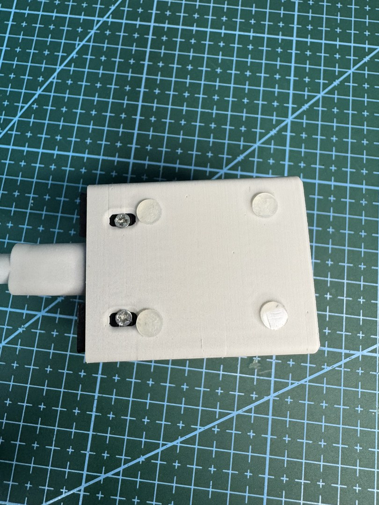

# Metro Clock

[한국어 README](README.ko.md) · [Firmware installation](#firmware-installation) · [Button and enclosure](#build-the-button-and-enclosure)

Metro Clock turns an **ESP8266 SD Pro Smart Weather Clock** into a desk display for Seoul-area train arrivals. It highlights the first train you can reach based on your walking time.

<p align="center">
  
  
</p>

## Features

- Seoul-area station picker with 19 lines, live arrival estimates, and Seoul weather
- Five favorites that store the line, station, direction, approach route, walking time, and brightness
- An optional GPIO4 button that cycles through occupied favorites in slot order
- **한국어** by default, with **English** available for the Metro settings page and clock display
- Firmware updates and Wi-Fi setup from the clock's web interface

## Settings page

Open the address shown on the clock and sign in with its device password. To follow the English screenshots, select **English** under **표시 언어** (Display language). For Seoul Open Data lines, [save your subway API key](#register-your-seoul-subway-api-key). Then choose a line, station, and direction and select **Save and apply**. To keep that setup, choose a slot under **Favorites** and select **Save current settings**.


Use **Wi-Fi, password, and firmware** at the bottom of the page to open `/system`.

## Hardware

| Supported device | Hardware | Tested starting firmware |
| --- | --- | --- |
| SD Pro Smart Weather Clock | ESP-12F / ESP8266, 4 MB flash, 240 × 240 ST7789 | `SDPro_V1.0.6` |

See the [SD Pro hardware notes](docs/specifications/hardware.md) to identify your board. For the optional button build, gather the following parts.

| Part | What you need |
| --- | --- |
| Power | USB-C |
| Switch | HB05 tactile switch, **6 × 6 × 5 mm**, **4 through-hole pins (DIP-4)**, normally open momentary |
| Wiring | Two thin insulated wires, soldering iron, and multimeter |
| Printed parts | Replacement outer shell, HB05 retainer, and optional fit gauges. Reuse the original inner tray, rear panel, and screws. |

## Firmware installation

Clone or download this repository. The firmware image is built from source. Complete the build while your computer has internet access.

### Option 1. Install with an agent (recommended)

Open this repository in Codex or Claude and paste the prompt below. [Agent installation guide](docs/INSTALL_AGENT.md)

```text
Read docs/INSTALL_AGENT.md and follow it to install Metro Clock on my SD Pro.
```

### Option 2. Install manually

1. **Build the firmware.** Open a terminal in the repository root. Create a Python 3 virtual environment with `python3 -m venv .venv` (`py -3 -m venv .venv` on Windows). Activate it with `source .venv/bin/activate` on Linux or macOS, or run the commands below using `.\.venv\Scripts\python.exe` in place of `python` on Windows.

   ```sh
   python -m pip install -r requirements-build.txt
   python scripts/make_release.py
   ```

   Upload the `.bin` named in `release/SHA256SUMS.txt`. If the directory contains older builds, the checksum file identifies the one just built.
2. **Upload the firmware.** For a first install, back up the full stock flash over UART if you may need to restore it. Open the stock SD Pro at its current IP and use its firmware update page. Keep the generated `SDP` filename prefix. For an existing Metro Clock, open the clock’s current IP with `/system` appended, sign in, select the file under **Firmware update**, and press **Install update**. Keep USB power connected until the clock reboots. [Backup and recovery](docs/MIGRATION.md)
3. **Install the web page and station catalog.** If the clock shows its setup screen, join **Smart Weather Clock** using the device password shown on the display. If the clock is already on your router, stay on the same network and replace `192.168.4.1` below with the clock’s LAN IP. Enter the device password at the prompt and look for **Verified 19 lines on the clock.**

   ```sh
   python scripts/metro_assets.py http://192.168.4.1
   ```

4. **Connect the clock to Wi-Fi.** If the clock is still in setup mode, open `http://192.168.4.1/system`, sign in, and enter the SSID and password of an internet-connected **2.4 GHz** Wi-Fi network. Click **Save and restart**. Rejoin that network on your computer and open the LAN IP shown by the clock just after it connects. If you miss it, look for `smartclock-XXXXXX` in the router’s connected-device list.
5. **Set the station.** Sign in at the clock’s LAN IP. For English, select **English** under **표시 언어**. For lines supplied by Seoul Open Data, [save your subway API key](#register-your-seoul-subway-api-key) before looking up directions. Pick a line, station, and direction, then click **Save and apply** (**저장하고 적용**).

### Register your Seoul subway API key

1. Sign in to Seoul Open Data and choose **실시간 지하철 인증키 신청** on the [key application page](https://data.seoul.go.kr/together/mypage/actkeyMain.do).
2. Open the LAN IP shown on the clock and sign in. Under **Data access** (**데이터 인증**), paste the key and click **Save API key** (**API 키 저장**). Wait for the saved confirmation before choosing a station and direction.

   

Airport Railroad (AREX) uses the operator’s feed and can be configured without a Seoul API key.

## Build the button and enclosure

### Wire and test the button



1. Unplug USB. Solder one wire to **GPIO4** on the ESP-12F module and the other to **GND**. In the [board photo](docs/specifications/board-esp12f.jpg), the copper antenna is on the right and GPIO4 is the fourth pad from the right on the lower row of eight pads. Verify the pad and ground on your board before soldering. [ESP-12F pinout](https://aithinker-static.oss-cn-shenzhen.aliyuncs.com/docs/Public%20Document%20Center/WiFi/esp8266/Specification/ESP-12F%20Specification-20220807.pdf)
2. Use continuity mode to find two button legs that connect **only while pressed**. Wire those legs between GPIO4 and GND.
3. With USB still unplugged, check for solder bridges and confirm that GPIO4 connects to GND only when the button is pressed. Power on and save at least two favorites to test cycling.



### Assemble the printed shell



[Shell STL](hardware/enclosure/outer-shell-v3.stl) · [HB05 retainer STL](hardware/enclosure/hb05-slide-retainer-v3.stl) · [OpenSCAD model](hardware/enclosure/metro-outer-shell-v3.scad) · [Fit gauges and print orientation](hardware/enclosure/README.md)

1. **Fit the button into the shell.** Insert the wired switch from inside, then slide the v3 retainer underneath it from the rear. Leave slack in the leads and check that the button returns freely.

   

2. **Slide in the original tray.** Feed it in from the rear with the display facing the bezel. Guide the wires clear of the tray edges and the display ribbon.

   

3. **Install both underside screws.** Start them loosely, position the tray so the bezel clears the LCD, then tighten gently. Connect USB-C and press the button to check that it advances through your favorites.

   

## Recovery

If the clock gets stuck at startup, power it on for less than 10 seconds twice, then power it on a third time and leave it running. When the screen shows **Recovery**, join the open **Smart Weather Clock** Wi-Fi, open `http://192.168.4.1/system`, and upload a known-good build. Restoring stock firmware requires a full flash backup and a UART connection. [Migration and recovery guide](docs/MIGRATION.md)

## Known limitations

- Train positions are estimates. The station catalog lists 19 lines, and live coverage and direction options depend on the data feed for each station.
- The clock serves its settings over local HTTP. Use a trusted network.

## Project documents

| Topic | Location |
| --- | --- |
| Firmware and web UI | [`src/`](src/) · [`web/`](web/) |
| Build and verification | [Build the firmware](#option-2-install-manually) · [Tests](tests/README.md) · [Changelog](CHANGELOG.md) |
| Data sources | [Seoul Open Data](https://data.seoul.go.kr/dataList/OA-12764/F/1/datasetView.do) · [Airport Railroad](https://www.airportrailroad.com/train/normal/live) · [Open-Meteo](https://open-meteo.com/) · [Polling notes](data/AREX-source-notes.md) |

## License

[GPL-3.0](LICENSE). Derived from [SmartClock-OSS](https://github.com/michaeldale/smartclock-oss). Third-party data and service terms apply to their respective sources.
