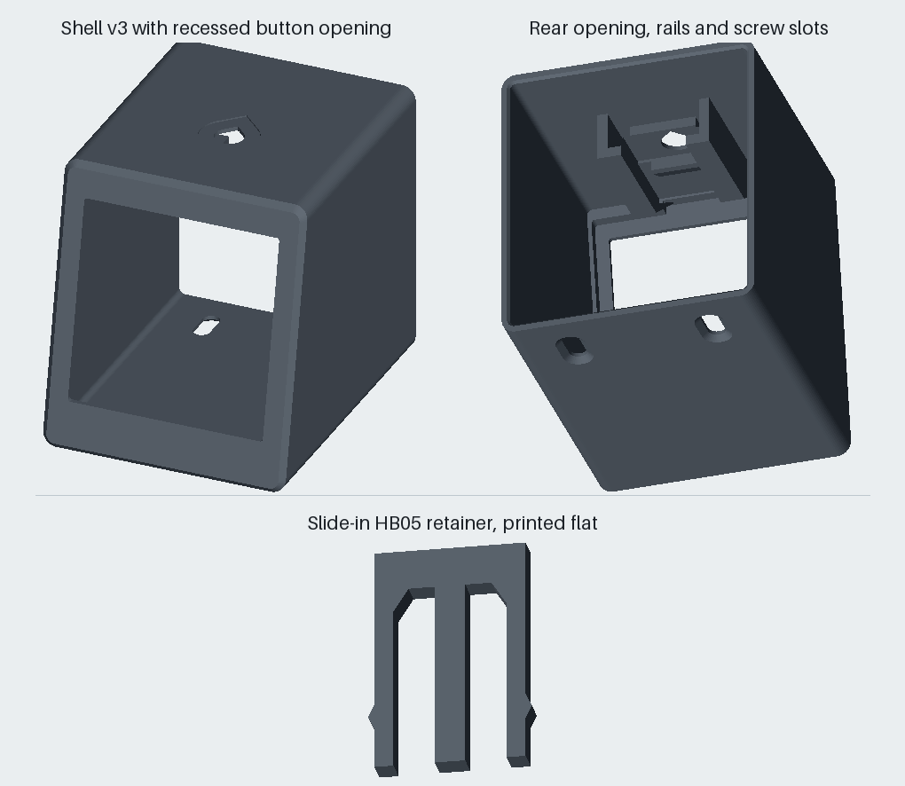

# Metro Clock replacement outer shell

## Print the v3 shell and retainer

Import the shell and retainer as separate objects and keep their exported orientations. The shell sits front-bezel down, and the retainer lies flat. The tapered rails and pointed upper edge of the button opening are designed to print with supports off.

| Part | File |
| --- | --- |
| Outer shell | [outer-shell-v3.stl](outer-shell-v3.stl) |
| Slide-in HB05 retainer | [hb05-slide-retainer-v3.stl](hb05-slide-retainer-v3.stl) |
| Button and rail fit coupon | [hb05-rail-fit-gauge-v3.stl](hb05-rail-fit-gauge-v3.stl) |
| Tray and screw fit gauge | [tray-fit-gauge-v2.stl](tray-fit-gauge-v2.stl) |
| Editable source | [metro-outer-shell-v3.scad](metro-outer-shell-v3.scad) |

1. Print the button and rail coupon with the retainer to check fit. The retainer is designed around a switch body about 3.5 mm tall, measured without the plunger or terminals.
2. With USB disconnected, solder the two wires. Insert the switch through the roof from inside, with its plunger facing out and its two pin pairs on the left and right.
3. Slide the forked end of the retainer in from the rear. The middle prong passes under the center of the switch body and the outer prongs run in the rails. Push until the side detents seat. Check that the switch body stays in place and that the plunger returns freely.
4. Route the wires clear of the tray, insert the tray, and start both screws loosely. Adjust the tray so the bezel clears the LCD and tighten gently. The v3 uses the same screw slots and LCD pocket as v2.

Pull the retainer's rear tab toward the open back to release the switch. Only its long outer prongs flex during insertion and removal. The 2.2 mm-thick retainer transfers button presses into the rails.

## Earlier versions

The original prototype and v2 snap-clip files are in [archive](archive/README.md).
